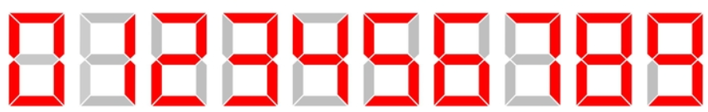

# 🔢 Seven Segment Display

This program **displays a number in seven-segment format** using LEDs! Each digit from 0 to 9 is represented by **seven segments** arranged like a digital clock. For a number with `k` digits, we use `k` of these seven segments side by side.


<p align="center">
  

## 📝 Description

Each segment is divided into **three main lines**:  

- **Top**  
- **Middle**  
- **Bottom**  

For the **top, middle, and bottom lines**, we use the character `"─"` (dash) repeated `b` times.  

> ⚠️ Note: `"─"` is **not part of the standard ASCII table**. To print it in C++, use:

```cpp
cout << "─";
```

The length of the three segment-cutting lines (top, bottom, and middle) for each digit is 2b+3, where b+b-1 is for the dash character and one space after each dash, and the remaining 4 is for two spaces at the beginning and two spaces at the end of these lines.

In the middle parts of the segment, in addition to the cutting lines, there are 2b+4 characters, where 2b of them are spaces, and the remaining 4 are for the beginning and end, depending on whether the character is on or off, it is either a "|" character (consisting of two letters for the beginning and end) or two spaces (two characters).

There is one space (one character) between each two numbers.

Overall, to display a number in seven segment format, we need to calculate the length of the three segment-cutting lines and the number of characters in the middle part for each digit, and then print the resulting segments for each digit with the appropriate spacing between them.

### 📥 Input
The input consists of a single line containing two natural numbers n and b separated by a space.

1 <= n <= 10^18

1 <= b <= 20

### 📤 Output
The output of your program should be the number n in seven segment format, as explained in the notes. Note that you must use the specified characters and follow the spacing notes.

## ⚙️ Implementation Notes

- **Top, middle, and bottom lines** → `2b + 3` characters long  
- **Middle vertical parts** → `2b + 4` characters, adjusted with `"|"` or spaces  
- **Spacing** → one space between digits  
- Use `"─"` carefully; it is **extended ASCII**  
- Follow exact formatting for consistent seven-segment display
